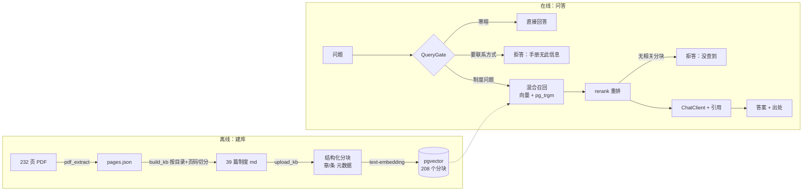

# 学生手册智能问答（Spring AI RAG）

把一所学校的《学生手册》（232 页 PDF）做成可问答的知识库系统：结构化分块 → 混合召回 → 重排 → 带引用的回答，并能拒绝回答手册里没有的内容。

> **English**: A RAG service over a 232-page university student-handbook PDF. Structural chunking, hybrid (vector + trigram) recall, cross-encoder rerank, citation-backed answers, and an explicit "not in the handbook" path. Java 25 / Spring Boot 4 / Spring AI 2, Vue 3 frontend, PostgreSQL + pgvector. Any OpenAI-compatible model endpoint can be used.

---

## 它解决什么问题

学生手册是一本 232 页的制度汇编，实际问题长这样：

- 「国家励志奖学金的奖励标准是多少？」——答案在某一章某一条里，翻 PDF 很难找。
- 「学籍异动要办哪些手续？」——答案散落在两三章。
- 「宿舍报修电话是多少？」——**手册里根本没有**，但向量检索一定会召回一堆「看起来相关」的段落，然后模型顺着编一个号码出来。

前两类是检索质量问题，第三类是**幻觉**。这个项目的重点是把第三类真正堵住，而不是靠调高相似度阈值自我安慰（实测「宿舍报修电话」的相似度 0.55，比不少正确答案还高）。

## 架构



四个关键设计：

| 设计 | 为什么这么做 |
|---|---|
| **按章/条结构化切分**，而不是按字数硬切 | 引用能落到「第 X 章第 Y 条」，也不会把一条制度劈成两半 |
| **向量 + trigram 混合召回**（RRF 融合，k=60） | 纯向量对「第三十条」「5000 元」这类精确片段不敏感；中文没有分词器时用 `pg_trgm` 的 `word_similarity` 兜住 |
| **cross-encoder 重排** | 召回的 top-20 里正确答案常排在第 3–8 位，重排后进 top-1 |
| **QueryGate 属性检查** | 联系方式类问题即使相似度很高也拒答，因为检索到的上下文里**没有电话/邮箱字段** |

## 快速开始

前提：Docker（20 GB 空闲）、一个 OpenAI 兼容的模型 API Key。

```bash
git clone https://github.com/Yyl-githu/handbook-rag.git
cd handbook-rag
cp .env.example .env       # 填 LLM_API_KEY / APP_PASSWORD / POSTGRES_PASSWORD
docker compose up -d --build
```

首次构建约 5–10 分钟（下载依赖 + 编译前端），之后打开 <http://localhost:8080>，账号 `admin`，密码是你在 `.env` 里设的 `APP_PASSWORD`。

**知识库开箱即用**：`db/ragdemo.dump` 里有 39 篇制度、208 个分块，数据库第一次启动时自动导入，不需要自己跑一遍 PDF 流水线。

验证是否正常：

```bash
curl http://localhost:8080/actuator/health
# {"status":"UP"}

docker exec ragdemo-pgvector psql -U user -d ragdemo -t -c "select count(*) from vector_store"
# 208
```

## 换模型

只要能提供 **OpenAI 兼容接口 + embedding 接口**，改 `.env` 即可，不用改代码、不用重建镜像：

```dotenv
LLM_BASE_URL=https://api.openai.com/v1
LLM_API_KEY=sk-...
LLM_CHAT_MODEL=gpt-4o-mini
LLM_EMBEDDING_MODEL=text-embedding-3-small
LLM_EMBEDDING_DIMENSIONS=1536
RERANK_ENABLED=false
```

| 变量 | 说明 |
|---|---|
| `LLM_BASE_URL` | 含版本路径，例如 `https://dashscope.aliyuncs.com/compatible-mode/v1` |
| `LLM_API_KEY` | 也接受 `DASHSCOPE_API_KEY` / `OPENAI_API_KEY` |
| `LLM_EMBEDDING_DIMENSIONS` | **必须和数据库向量列一致**（预置数据是 1536） |
| `RERANK_ENABLED` | 只有百炼有独立 rerank 接口；换别家设 `false`，检索自动退化为 RRF 融合顺序 |

两个坑：

1. **改 embedding 模型 = 改向量维度 = 必须重建知识库**（重跑 `pipeline/`，或 `docker compose down -v` 后重新导入）。
2. 关掉 rerank 后 `hit@1` 从 1.00 掉到 0.94 左右（见下方评估）。

## 不用 Docker

需要 JDK 25、Maven 3.9+、Node 20+、PostgreSQL 17 + pgvector 0.8。

```bash
cd web && npm ci && npm run build && cd ..   # 前端产物写入 src/main/resources/static
./mvnw -DskipTests package
java -jar target/spring-ai-rag-demo-3.0.1.jar --spring.profiles.active=aliyun
```

数据库默认 `jdbc:postgresql://localhost:5432/ragdemo`，可用 `DB_URL`/`DB_USER`/`DB_PASSWORD` 覆盖。用 `db/ragdemo.dump` 初始化：

```bash
createdb -U user ragdemo
pg_restore -U user -d ragdemo --no-owner --no-privileges db/ragdemo.dump
```

## 重建知识库

仓库已带建库结果（`kb/` 39 篇 + `db/ragdemo.dump`），只有换手册或换切分策略时才需要重跑：

```bash
python pipeline/pdf_extract.py 手册.pdf pipeline/pages.json pipeline/_starts.txt
python pipeline/build_kb.py pipeline/pages.json kb/
RAG_PASS=你的密码 python pipeline/upload_kb.py kb/     # 服务需已启动且知识库为空
```

`pipeline/build_kb.py` 靠 PDF 每页页脚自带的页码 + 目录页定位章节边界，换成没有页码的 PDF 不能直接用。详见 [pipeline/README.md](pipeline/README.md)。

## 评估

两套题集共 42 题，全部人工编写并标注预期来源章节（不是模型自动生成）：

| 题集 | 规模 | 侧重 |
|---|---|---|
| `eval/handbook_eval_questions.jsonl` | 20 题 | 基础召回 |
| `eval/handbook_eval_v2.jsonl` | 22 题 | 易混淆章节、精确数值、负样本（手册里没有）、多跳 |

实测（topK=8，阈值 0.3）：

| 配置 | hit@1 | hit@3 | MRR | 负样本拒答 | 拒答准确率 |
|---|---|---|---|---|---|
| 向量 + 硬切分 | 0.75 | 0.85 | 0.800 | — | — |
| 向量 + 结构化切分 | 0.80 | 0.90 | 0.850 | 5/5 | 20/20 |
| 混合召回（无重排） | 0.95 | 1.00 | 0.975 | 5/5 | 20/20 |
| 混合 + 重排（v1） | **1.00** | **1.00** | **1.000** | 5/5 | 20/20 |
| 混合召回（v2 困难集） | 0.88 | 1.00 | 0.941 | 5/5 | 22/22 |
| 混合 + 重排（v2 困难集） | **1.00** | **1.00** | **1.000** | 5/5 | 22/22 |

代价：混合召回 0.26 s/题，加重排 0.43 s/题（不含模型生成）。复现见 [eval/README.md](eval/README.md)：

```bash
# 参数：[题集] [输出] [topK] [mode]
RAG_PASS=你的密码 python eval/eval_runner_v2.py eval/handbook_eval_v2.jsonl eval/v2_hybrid_rerank.json 8 hybrid_rerank
```

## 接口

| 方法 | 路径 | 用途 |
|---|---|---|
| `POST` | `/api/v2/chat` | 问答（带 `sources` 引用） |
| `GET` | `/api/v2/chat/stream` | 流式问答（SSE） |
| `GET` | `/api/v2/gate?q=` | 只做闸门判定，不生成（评估用） |
| `GET` | `/api/v2/retrieval?q=` | 只做检索并返回分数（评估用） |
| `POST` | `/api/v2/documents` | 上传文档入库 |
| `DELETE` | `/api/v2/documents/{id}` | 删除文档 |
| `POST` | `/v1/chat/completions` | OpenAI 兼容端点（可接 Open WebUI） |
| `GET` | `/actuator/health` | 健康检查（免登录） |

除 `/login.html`、`/assets/**`、`/actuator/health` 外都需要登录：浏览器用表单登录，脚本用 HTTP Basic。

```bash
curl -u admin:密码 "http://localhost:8080/api/v2/gate?q=国家励志奖学金"
```

## 安全

- 单账号登录（`APP_USERNAME`/`APP_PASSWORD`），Spring Security 表单 + Basic；
- 密码 BCrypt 存储，会话 Cookie `HttpOnly` + `SameSite=Lax`；
- **CSRF 关闭**（同源 API + `SameSite=Lax` 的取舍）；
- 密钥不进镜像也不进仓库：`.env` 被 `.gitignore` 排除，`docker compose` 缺变量时直接报错退出。

## 已知限制

1. **单账号、无角色**。多人使用需要自己做用户体系。
2. **HTTP 明文**。放公网必须加反向代理做 TLS，并限制登录频率。
3. **CSRF 关闭**。靠 `SameSite=Lax` 缓解，有跨站需求时要重新评估。
4. **依赖外部模型 API**。断网或 Key 失效时问答不可用（应用仍能启动，`/actuator/health` 仍为 UP）。
5. **知识库只覆盖这本手册**。换学校/换手册要重跑切分流水线，页码规则不一定通用。
6. **HNSW 索引跨机器有细微差异**，换环境偶尔会变 top-1，评估数字以本机为准。
7. **只评估了检索与拒答，没有做答案级评分**。「检索对了」不等于「答对了」，这是当前评估最大的短板。

## 目录

```
src/         Spring Boot 后端（Java 25）
web/         Vue 3 前端（Vite）
kb/          39 篇结构化制度 Markdown（建库产物）
pipeline/    PDF → Markdown → 入库 脚本
eval/        两套题集、评估脚本、各配置结果
db/          数据库种子（ragdemo.dump + 首次启动导入脚本）
```

## 许可

代码基于 [arvindand/spring-ai-rag-demo](https://github.com/arvindand/spring-ai-rag-demo)（MIT），见 [LICENSE](LICENSE)。
`kb/` 中的制度文本来自贵州财经大学《学生手册》，仅作技术演示，版权归学校所有，如需使用请自行取得授权。